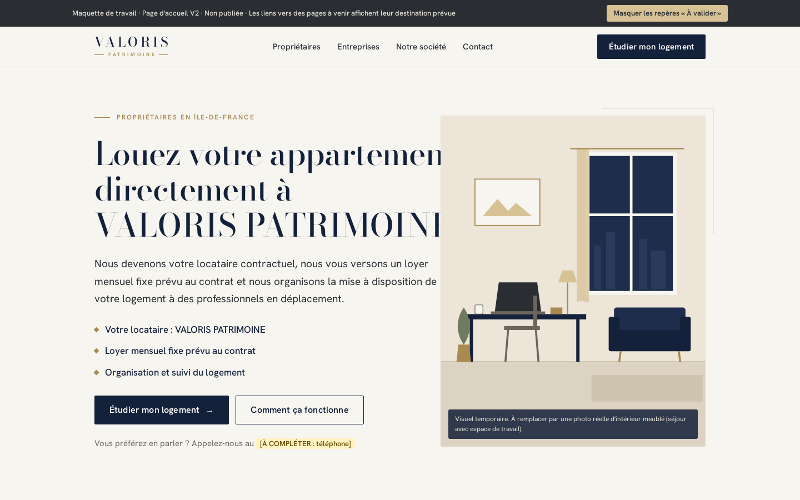
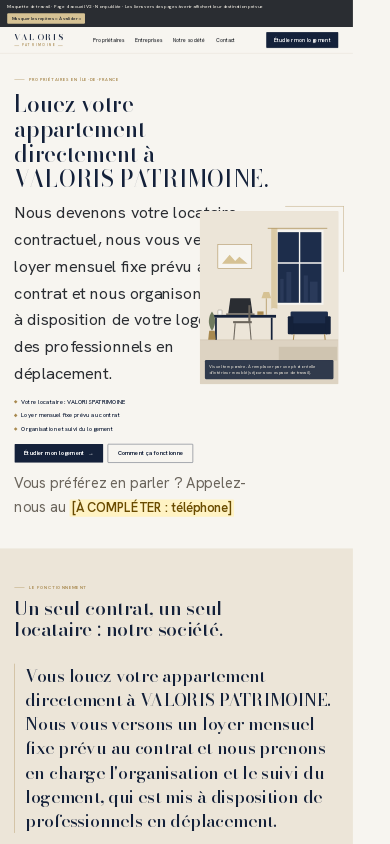
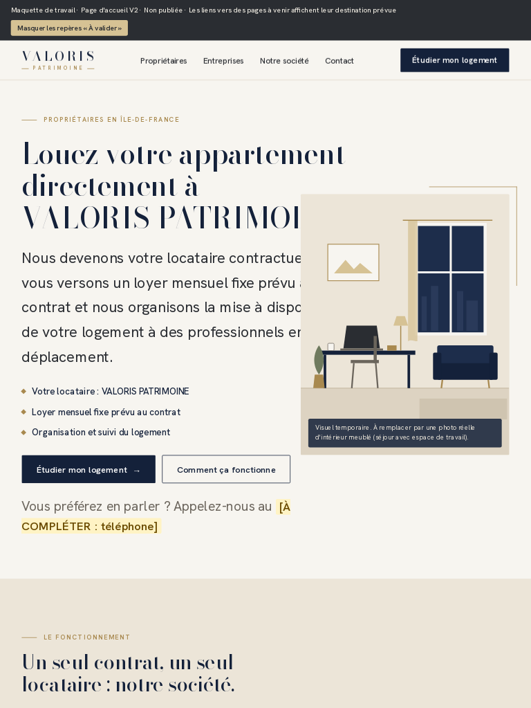

# Captures d'écran - VALORIS PATRIMOINE

Fichiers générés automatiquement à chaque mise à jour du site. Ne pas modifier cette branche à la main.

- Site capturé : https://ystest1.github.io/VLS/
- Commit du site : `d79fc25`
- Date (UTC) : 2026-11-01T10:11:02Z
- Version en ligne confirmée identique au commit : **oui**
- Méthode de vérification : avant captures : déploiement le plus récent (7471561415, 2026-11-01T10:09:44Z) = commit d79fc25, statut success, contenu servi identique à index.html | après captures : confirmée - déploiement le plus récent (7471561415, 2026-11-01T10:09:44Z) = commit d79fc25, statut success
- Rapport technique : https://raw.githubusercontent.com/Ystest1/VLS/screenshots/screenshots/rapport.json

## Liens permanents (toujours la dernière version)

### Ordinateur (1440 px)

- Page entière : https://raw.githubusercontent.com/Ystest1/VLS/screenshots/screenshots/homepage-desktop.png
- Premier écran : https://raw.githubusercontent.com/Ystest1/VLS/screenshots/screenshots/homepage-desktop-premier-ecran.png
- Tranches : [1](https://raw.githubusercontent.com/Ystest1/VLS/screenshots/screenshots/parts/homepage-desktop-part-01.png) | [2](https://raw.githubusercontent.com/Ystest1/VLS/screenshots/screenshots/parts/homepage-desktop-part-02.png) | [3](https://raw.githubusercontent.com/Ystest1/VLS/screenshots/screenshots/parts/homepage-desktop-part-03.png) | [4](https://raw.githubusercontent.com/Ystest1/VLS/screenshots/screenshots/parts/homepage-desktop-part-04.png)
- Dimensions : 1440 x 7520 px (capture Chromium pleine page)
- Attention : Balise <meta name="viewport"> absente.
- Attention : Déclaration <!doctype html> absente : le navigateur affiche la page en mode de compatibilité (quirks).

### Mobile (390 px)

- Page entière : https://raw.githubusercontent.com/Ystest1/VLS/screenshots/screenshots/homepage-mobile.png
- Premier écran : https://raw.githubusercontent.com/Ystest1/VLS/screenshots/screenshots/homepage-mobile-premier-ecran.png
- Tranches : [1](https://raw.githubusercontent.com/Ystest1/VLS/screenshots/screenshots/parts/homepage-mobile-part-01.png) | [2](https://raw.githubusercontent.com/Ystest1/VLS/screenshots/screenshots/parts/homepage-mobile-part-02.png) | [3](https://raw.githubusercontent.com/Ystest1/VLS/screenshots/screenshots/parts/homepage-mobile-part-03.png) | [4](https://raw.githubusercontent.com/Ystest1/VLS/screenshots/screenshots/parts/homepage-mobile-part-04.png)
- Dimensions : 390 x 6892 px (assemblage par segments (page de plus de 15000 px))
- Attention : Balise <meta name="viewport"> absente.
- Attention : Déclaration <!doctype html> absente : le navigateur affiche la page en mode de compatibilité (quirks).
- Attention : Débordement horizontal : la page défile sur le côté.

### Tablette (768 px)

- Page entière : https://raw.githubusercontent.com/Ystest1/VLS/screenshots/screenshots/homepage-tablet.png
- Premier écran : https://raw.githubusercontent.com/Ystest1/VLS/screenshots/screenshots/homepage-tablet-premier-ecran.png
- Tranches : [1](https://raw.githubusercontent.com/Ystest1/VLS/screenshots/screenshots/parts/homepage-tablet-part-01.png) | [2](https://raw.githubusercontent.com/Ystest1/VLS/screenshots/screenshots/parts/homepage-tablet-part-02.png) | [3](https://raw.githubusercontent.com/Ystest1/VLS/screenshots/screenshots/parts/homepage-tablet-part-03.png) | [4](https://raw.githubusercontent.com/Ystest1/VLS/screenshots/screenshots/parts/homepage-tablet-part-04.png) | [5](https://raw.githubusercontent.com/Ystest1/VLS/screenshots/screenshots/parts/homepage-tablet-part-05.png)
- Dimensions : 980 x 10474 px (capture Chromium pleine page)
- Attention : Mise en page de 980 px au lieu de 768 px : sur un vrai appareil, la page s'affiche réduite (balise meta viewport absente ?).
- Attention : Balise <meta name="viewport"> absente.
- Attention : Déclaration <!doctype html> absente : le navigateur affiche la page en mode de compatibilité (quirks).

## Version figée de cette capture

Dossier : https://github.com/Ystest1/VLS/tree/screenshots/history/2026-11-01_101103_d79fc25

Les liens de l'historique ne changent jamais : ils servent à comparer deux versions.
Les liens permanents peuvent mettre jusqu'à 5 minutes à refléter la dernière capture (cache de GitHub).

## Aperçu

**Ordinateur (1440 px) - premier écran**

**Mobile (390 px) - premier écran**

**Tablette (768 px) - premier écran**

